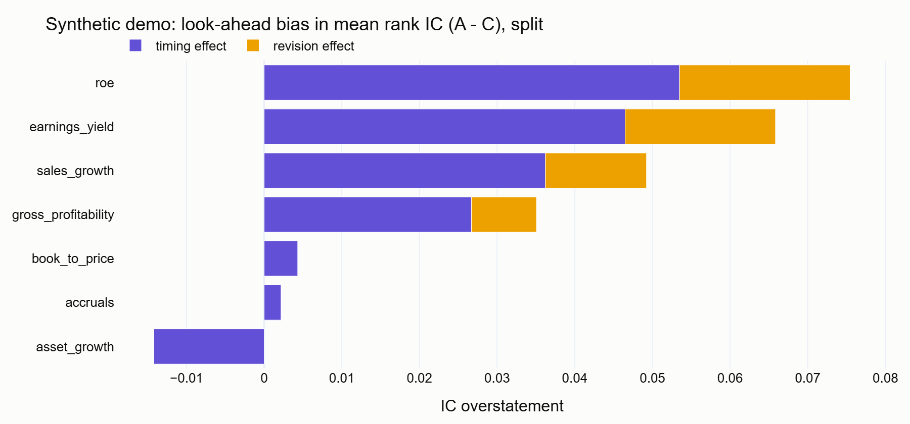
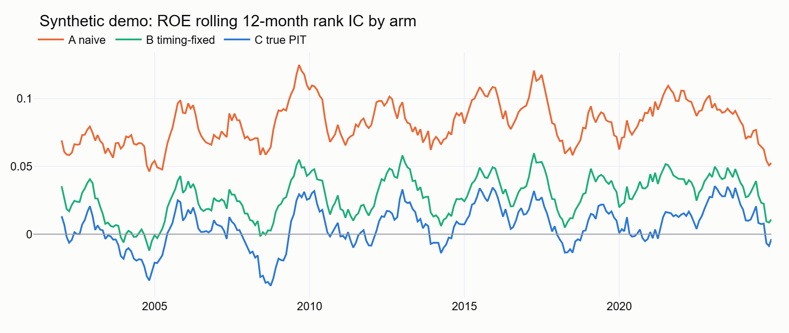
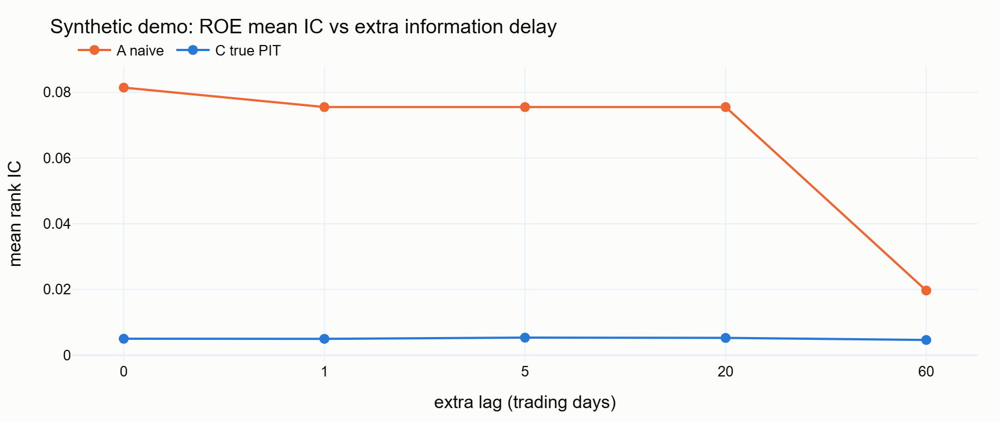

# pit-two-clocks

**Results site: <https://polomese.github.io/ai_quant/>** (the experiment, hypotheses and every
chart, no install needed)

Backtests usually look better than live trading. One reason is that their inputs are not
**point-in-time (PIT)**: they use numbers before they were published, or numbers that were
restated afterwards. This project measures how much of a fundamental factor's apparent
performance comes from those two kinds of look-ahead, using Sharadar's as-reported and restated
fundamentals. It is a reproducible student study: synthetic data with planted bias validates
the method, and real data supplies the measurement.

## The two clocks

| Clock | What evolves | Look-ahead it creates | Status |
|---|---|---|---|
| **1. Data** | A value is knowable only from its *filing date*, and it may be *restated* later | Timing (using it before filing) and revision (using the restated value) | implemented |
| **2. Model** | A model trained after an event "knows" the outcome (for example, LLM news sentiment) | Memorization | interfaces only (`src/pitlab/clock2`) |

Clock 1 is measured with three arms that differ **only** in information timing:

| Arm | Values | Usable from |
|---|---|---|
| A, naive | restated (MRQ/MRT) | fiscal period end |
| B, timing-fixed | restated (MRQ/MRT) | original filing date + 1 trading day |
| C, true PIT | as first reported (ARQ/ART) | own filing date + 1 trading day |

**Timing effect = A − B · revision effect = B − C · total bias = A − C**, measured on rank IC,
Fama-MacBeth slopes, and decile long-short portfolios, plus a lag sweep (+0 to +60 trading days).
The details are in [docs/METHODOLOGY.md](docs/METHODOLOGY.md).

## Quickstart (synthetic data, no API key, under 5 minutes)

```bash
# needs uv: https://docs.astral.sh/uv/
git clone <this repo> && cd pit-two-clocks
uv sync
uv run pitlab data synthetic          # 800 fake stocks x 25 years with planted look-ahead (~5 s)
uv run pitlab run --run-id demo       # 3 arms + lag sweep (~30 s)
uv run pitlab report --run-id demo    # outputs/demo/summary.md + report.html
uv run pitlab dashboard               # http://localhost:8501
```

**Keeping the venv and data out of the checkout (recommended; the folder may be cloud-synced).**
On Windows, `scripts/bootstrap.ps1` does everything in one go. It sets
`UV_PROJECT_ENVIRONMENT` (venv location) and `PITLAB_DATA_ROOT` (data root; this project uses
`$PITLAB_DATA_ROOT/pit-two-clocks/{data,outputs}`), installs uv and Python 3.12, syncs the
locked dependencies, and builds the synthetic demo:

```powershell
powershell -ExecutionPolicy Bypass -File scriptsootstrap.ps1 -VenvRoot P:\Python_venv -DataRoot P:\quant_data
```

If `PITLAB_DATA_ROOT` is unset, data and outputs fall back to `data/` and `outputs/` inside the
repo (both gitignored).

On synthetic data the method must recover what was planted. Earnings yield, ROE, sales growth,
and gross profitability show **A > B > C**, while the controls (book-to-price, asset growth,
accruals) show no revision effect. The end-to-end test asserts this.





*All figures come from the synthetic demo; they validate the method and say nothing about real
markets.*

## Using Sharadar data

1. Get an API key at <https://sharadar.com/account>. The free tier needs no card and covers the
   Dow 30 sample. The Full History Bundle is needed for real conclusions.
2. `cp .env.example .env` and set `SHARADAR_API_KEY=...`.
3. Run:
   ```bash
   uv run pitlab data download --tables all   # bulk zip if your plan allows, else per-ticker REST
   uv run pitlab data validate                # fails loudly on bad keys/dates/prices
   uv run pitlab run --run-id sharadar
   uv run pitlab dashboard
   ```

Every download is kept as `data/raw/<table>/<timestamp>/` with a `manifest.json` (row counts,
sha256, license tier). Snapshots are never overwritten, so you build your own vintage archive.
Downloads are resumable (`--resume <timestamp>`).

> **Free tier = illustrative only.** About 30 surviving mega-caps are far too few, and too
> survivorship-biased, for valid cross-sectional statistics. The dashboard shows a warning.
> The code path is identical on the paid full-history bundle; only the universe changes.

### Data license

Sharadar data is sold under a **Personal Use License: personal, non-professional use, no
redistribution**. This repository contains **no Sharadar data**, raw or processed.
`.gitignore` excludes `data/`, `*.parquet`, `*.duckdb`, `.env`, and `outputs/`, and a pre-commit
hook blocks data files and anything over 5 MB. Committed figures come only from synthetic runs.
If you fork this, keep it that way.

## Commands

| Command | What it does |
|---|---|
| `pitlab data synthetic [--n-stocks N --years Y --seed S]` | fake Sharadar-shaped dataset |
| `pitlab data download --tables all [--method auto\|bulk\|rest]` | Sharadar download + ingest |
| `pitlab data validate` | PK uniqueness, date sanity, ticker coverage, prices ≥ 0 |
| `pitlab data update [--full]` | daily incremental top-off / weekly bulk refresh (see `scripts/register_tasks.ps1`) |
| `pitlab run --run-id NAME [--no-lag-sweep]` | full experiment → `outputs/NAME/` |
| `pitlab run --lag-sweep --run-id NAME` | lag sweep only (added to that run) |
| `pitlab report --run-id NAME` | static `summary.md` + `report.html` |
| `pitlab dashboard` | Streamlit app |
| `pitlab site --run-id NAME [--out FILE]` | one self-contained offline HTML version of the dashboard (aggregate results only; opens in any browser, no Python needed) |

Each run writes `config_used.yaml`, `ic_monthly`, `ic_summary`, `effects`, `portfolio_returns`,
`portfolio_summary`, `fm_results`, `fm_monthly`, `contamination`, `lag_sweep` (Parquet),
`summary.json`, and `summary.md`.

## Development

```bash
uv sync --all-groups
uv run pre-commit install
uv run pytest -q && uv run ruff check . && uv run mypy
```

Key tests: `tests/test_asof.py` contains hand-built PIT proofs (a filing after the rebalance is
invisible to C, A sees it, and B is restated but only after filing). The other key test is
`tests/test_end_to_end_synthetic.py`. CI runs lint, the tests, and a CLI smoke test on synthetic
data only.

Layout: `config/` (settings and the column map), `src/pitlab/` (data, pit, signals, returns,
backtest, stats, report, clock2), `dashboard/app.py`, `docs/` (METHODOLOGY, DATA_NOTES, PLAN),
and `notebooks/01_explore.ipynb`.

## Roadmap

- [ ] Run on the Sharadar full-history bundle and write up the real decomposition
- [ ] Sensitivity: delisting-return assumption, staleness window, quantile count, VW vs EW
- [ ] Use the accumulating snapshot archive to measure *intermediate* revisions, not only first vs latest
- [ ] Event-time analysis around filing dates (does arm A's edge sit in the filing month?)
- [ ] Clock 2: plug a news source and `DatedScorer`s into the same IC, compare, and dashboard machinery
      (IC discontinuity at the model cutoff, model-vintage ladder, anonymization, memorization probes)
